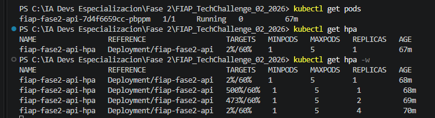
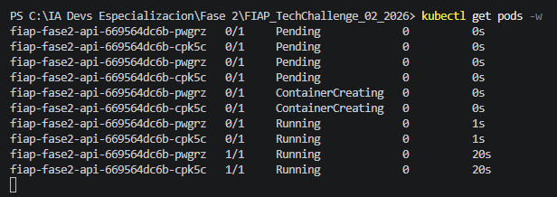
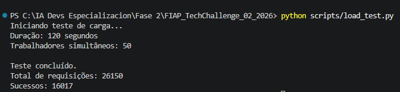

# FIAP Tech Challenge — Fase 2

## Projeto 1 — Otimização de Modelos de Diagnóstico

Projeto desenvolvido para o **Tech Challenge da Fase 2 da Pós-Tech FIAP — Inteligência Artificial para Desenvolvedores**.

A solução evolui o trabalho realizado na Fase 1, aplicando **Algoritmos Genéticos para otimização de hiperparâmetros**, análise de threshold, explicabilidade com SHAP, integração com LLM, disponibilização por API REST, testes automatizados, observabilidade e escalabilidade automática com Kubernetes.

---

## 1. Objetivo

O objetivo do projeto é otimizar um modelo de classificação de câncer de mama desenvolvido na Fase 1 e evoluí-lo para uma arquitetura mais próxima de um sistema real.

A solução contempla:

- otimização de hiperparâmetros com Algoritmo Genético;
- comparação quantitativa com o modelo original;
- três experimentos com diferentes configurações do GA;
- análise do threshold de decisão;
- explicabilidade global e individual com SHAP;
- interpretação dos resultados utilizando uma LLM;
- prompt engineering;
- avaliação da qualidade das interpretações;
- API REST com FastAPI;
- testes automatizados;
- Docker;
- logging;
- métricas em formato compatível com Prometheus;
- Kubernetes;
- Metrics Server;
- escalabilidade automática com Horizontal Pod Autoscaler.

Fluxo geral:

```text
Dados do paciente
        │
        ▼
FastAPI
        │
        ▼
Pipeline de Machine Learning
        │
        ├── StandardScaler
        └── LogisticRegression
        │
        ▼
Probabilidade de malignidade
        │
        ▼
Threshold de decisão
        │
        ▼
Classificação
        │
        ▼
SHAP
        │
        ▼
Principais fatores
        │
        ▼
Prompt estruturado
        │
        ▼
LLM
        │
        ▼
Interpretação em linguagem natural
```

---

# 2. Dataset

Foi utilizado o **Breast Cancer Wisconsin Diagnostic Dataset**.

O conjunto possui:

- 569 registros;
- 30 variáveis preditoras;
- variável alvo `diagnosis`.

Classes:

```text
B = Benigno
M = Maligno
```

Durante o pré-processamento foram removidas as colunas:

```text
id
Unnamed: 32
```

A variável alvo foi convertida para:

```text
Benigno = 0
Maligno = 1
```

A separação treino/teste foi realizada com:

```text
80% treino
20% teste
stratify = y
random_state = 42
```

O conjunto de teste permaneceu isolado das etapas de seleção de hiperparâmetros e threshold.

---

# 3. Estrutura do Projeto

```text
FIAP_TechChallenge_02_2026/
│
├── api/
│   ├── __init__.py
│   └── main.py
│
├── src/
│   ├── __init__.py
│   ├── prediction_service.py
│   ├── explainability_service.py
│   ├── llm_service.py
│   └── logging_config.py
│
├── notebooks/
│   ├── 01_baseline_fase1.ipynb
│   ├── 02_algoritmo_genetico.ipynb
│   ├── 03_threshold_e_explicabilidade.ipynb
│   └── 04_llm.ipynb
│
├── data/
│   └── data.csv
│
├── models/
│   └── modelo_ga_fase2.joblib
│
├── results/
│   ├── baseline_fase1.json
│   ├── comparacao_fase1_vs_ga.csv
│   ├── experimentos_algoritmo_genetico.csv
│   ├── resultado_final_ga.json
│   ├── threshold_otimizado.json
│   ├── importancia_variaveis_shap.csv
│   ├── analise_threshold_030.csv
│   ├── comparacao_shap_fase1_vs_ga.csv
│   ├── avaliacao_qualidade_llm.csv
│   ├── avaliacao_automatica_llm.csv
│   ├── avaliacao_llm_juiz.csv
│   └── comparacao_prompts_v1_v2.csv
│
├── tests/                      # testes automatizados (pytest)
│   ├── test_api.py
│   ├── test_prediction_service.py
│   └── test_explainability_service.py
│
├── scripts/                    # execução manual (exigem a API rodando)
│   ├── test_predict_manual.py
│   ├── test_interpret_manual.py
│   └── load_test.py
│
├── docs/
│   ├── arquitetura.md
│   └── evidencias/
│       ├── 01_hpa_escalado_replicas.png
│       ├── 02_kubernetes_criacao_pods.png
│       └── 03_resultado_teste_carga.png
│
├── k8s/
│   ├── deployment.yaml
│   ├── service.yaml
│   ├── hpa.yaml
│   ├── secret.example.yaml
│   └── metrics-server-patch.yaml   # somente ambiente local
│
├── logs/
│
├── Dockerfile
├── docker-compose.yml
├── requirements.txt
├── .env.example
├── .gitignore
└── README.md
```

O arquivo `.env` real não é versionado.

---

# 4. Notebooks

## 4.1 `01_baseline_fase1.ipynb`

Reproduz o cenário de referência da Fase 1.

Inclui:

- carregamento do dataset;
- pré-processamento;
- separação treino/teste;
- modelo original;
- modelo otimizado anteriormente com GridSearch;
- avaliação das métricas;
- persistência dos resultados de baseline.

---

## 4.2 `02_algoritmo_genetico.ipynb`

Implementa manualmente o Algoritmo Genético utilizado para otimização dos hiperparâmetros.

São implementados:

- representação dos genes;
- geração da população;
- seleção;
- crossover uniforme;
- mutação;
- elitismo;
- função fitness;
- evolução por gerações;
- cache de avaliações;
- três experimentos;
- análise da geração em que cada experimento atingiu o ótimo;
- comparação com o modelo da Fase 1.

---

## 4.3 `03_threshold_e_explicabilidade.ipynb`

Responsável por:

- geração de probabilidades out-of-fold;
- análise de thresholds;
- seleção através de F2-score;
- comparação entre thresholds;
- avaliação final no conjunto de teste;
- análise do threshold 0,30 recomendado na avaliação da Fase 1;
- explicabilidade global com SHAP;
- explicabilidade individual com SHAP;
- análise SHAP do falso negativo restante;
- consistência do SHAP entre o modelo da Fase 1 e o modelo otimizado.

---

## 4.4 `04_llm.ipynb`

Responsável por:

- preparação do contexto do paciente;
- integração com a API da LLM;
- prompt engineering;
- geração de explicações;
- avaliação em diferentes cenários;
- prompt v2 com zona de incerteza, percentis e pontos de atenção;
- avaliação manual, automática e por LLM (LLM-as-a-judge);
- comparação entre as versões v1 e v2 do prompt.

---

# 5. Pipeline de Machine Learning

O modelo utiliza um `Pipeline` do Scikit-learn:

```text
Entrada
  │
  ▼
StandardScaler
  │
  ▼
LogisticRegression
```

O uso do `StandardScaler` dentro do Pipeline garante que a mesma transformação seja aplicada durante treinamento e inferência e reduz o risco de vazamento de dados durante a validação cruzada.

O Pipeline completo é persistido em:

```text
models/modelo_ga_fase2.joblib
```

---

# 6. Algoritmo Genético

## 6.1 Representação

Cada indivíduo possui três genes:

```text
[C, class_weight, solver_penalty]
```

O terceiro gene representa uma combinação válida de `solver` e `penalty`.

Essa decisão evita gerar combinações incompatíveis durante o processo evolutivo.

Exemplo do indivíduo vencedor:

```text
[2, 1, 1]
```

Decodificação:

```text
C = 0.1
class_weight = balanced
solver = liblinear
penalty = l2
```

---

## 6.2 Operadores Genéticos

Foram implementados:

- seleção;
- crossover uniforme;
- mutação;
- elitismo;
- substituição de gerações.

---

## 6.3 Função Fitness

A função fitness utiliza validação cruzada estratificada com cinco divisões no conjunto de treinamento.

```text
Fitness =
0,50 × Recall
+
0,30 × F1-score
+
0,20 × ROC-AUC
```

O Recall recebeu maior peso devido à importância de reduzir falsos negativos em um problema relacionado a diagnóstico.

---

# 7. Experimentos do Algoritmo Genético

Foram realizados três experimentos independentes.

| Experimento   | População | Gerações | Mutação | Elitismo | Fitness | Recall CV |  F1 CV | ROC-AUC CV | Avaliações |   Tempo |
| ------------- | --------: | -------: | ------: | -------: | ------: | --------: | -----: | ---------: | ---------: | ------: |
| Experimento 1 |        20 |       15 |    0,05 |        2 |  0,9686 |    0,9588 | 0,9674 |     0,9949 |         61 |  8,60 s |
| Experimento 2 |        30 |       20 |    0,10 |        2 |  0,9686 |    0,9588 | 0,9674 |     0,9949 |         79 | 12,35 s |
| Experimento 3 |        40 |       25 |    0,20 |        4 |  0,9686 |    0,9588 | 0,9674 |     0,9949 |         89 | 13,49 s |

Os três experimentos convergiram para o mesmo melhor fitness.

O **Experimento 1** foi selecionado como vencedor por alcançar a mesma solução com menor custo computacional.

Melhor configuração:

```text
C = 0.1
class_weight = balanced
solver = liblinear
penalty = l2
```

Fitness de validação:

```text
0,9686267399
```

---

# 8. Resultados — Fase 1 × Algoritmo Genético

Resultados obtidos no conjunto de teste:

| Modelo                      |   Accuracy |  Precision |     Recall |   F1-score |    ROC-AUC |    FN |    FP |
| --------------------------- | ---------: | ---------: | ---------: | ---------: | ---------: | ----: | ----: |
| GridSearch — Fase 1         |     0,9737 |     0,9756 |     0,9524 |     0,9639 |     0,9954 |     2 |     1 |
| GA — Fase 2, threshold 0,50 | **0,9912** | **1,0000** | **0,9762** | **0,9880** | **0,9977** | **1** | **0** |
| GA — Fase 2, threshold 0,34 |     0,9474 |     0,8913 |     0,9762 |     0,9318 |     0,9977 |     1 |     5 |

O modelo otimizado pelo Algoritmo Genético apresentou melhora em todas as principais métricas em relação ao modelo da Fase 1 utilizando threshold `0,50`.

Principais resultados:

```text
Accuracy  = 99,12%
Precision = 100,00%
Recall    = 97,62%
F1-score  = 98,80%
ROC-AUC   = 99,77%
```

Falsos negativos:

```text
2 → 1
```

Falsos positivos:

```text
1 → 0
```

---

# 9. Análise de Threshold

O threshold padrão é:

```text
0,50
```

A análise adicional foi realizada exclusivamente sobre o conjunto de treinamento utilizando probabilidades out-of-fold geradas com:

```text
StratifiedKFold
n_splits = 5
shuffle = True
random_state = 42
```

Foram avaliados thresholds entre:

```text
0,20 e 0,60
```

com incremento de:

```text
0,01
```

Critério de seleção:

```text
Maior F2-score em validação cruzada
```

O threshold selecionado foi:

```text
0,34
```

Entretanto, o benefício observado na validação não se confirmou no conjunto de teste.

### Threshold 0,50

```text
Accuracy = 0,9912
Precision = 1,0000
Recall = 0,9762
F1 = 0,9880
FN = 1
FP = 0
```

### Threshold 0,34

```text
Accuracy = 0,9474
Precision = 0,8913
Recall = 0,9762
F1 = 0,9318
FN = 1
FP = 5
```

A redução do threshold não reduziu a quantidade de falsos negativos no conjunto de teste.

Portanto, o experimento demonstra que a seleção de threshold precisa ser validada em dados não utilizados durante sua otimização.

**Decisão:** a API mantém o threshold `0,34`. Ele foi escolhido antes de observar o conjunto de teste, e trocá-lo por `0,50` com base no resultado do teste transformaria o teste em dado de validação (vazamento). O resultado do teste é registrado de forma transparente como limitação.

O threshold fica em `results/threshold_otimizado.json` e pode ser alterado sem retreinar o modelo.

### Recomendação da avaliação da Fase 1: threshold 0,30

| Modelo | Threshold | FN | FP |
|---|---:|---:|---:|
| Fase 1 (GridSearchCV) | 0,50 | 2 | 1 |
| Fase 1 (GridSearchCV) | 0,30 | 2 | 2 |
| Fase 2 (Algoritmo Genético) | 0,50 | 1 | 0 |
| Fase 2 (Algoritmo Genético) | 0,30 | 1 | 5 |

Com `0,30` os falsos negativos **não foram eliminados** em nenhum dos modelos. A redução de falsos negativos (2 → 1) veio da otimização com Algoritmo Genético. Zerar os falsos negativos do modelo otimizado exigiria um threshold ≤ 0,22 (7 falsos positivos), valor encontrado observando o próprio teste e, por isso, não adotado.

---

# 10. Explicabilidade com SHAP

Foi utilizado:

```text
SHAP LinearExplainer
```

sobre a Regressão Logística.

O background utilizado pelo explicador é:

```text
X_train padronizado
```

O processamento é:

```text
X_train
   │
   ▼
StandardScaler
   │
   ▼
X_train padronizado
   │
   ▼
LinearExplainer
```

Para cada paciente, são selecionados os cinco fatores com maior valor absoluto de SHAP.

Exemplo:

```json
{
  "variavel": "radius_se",
  "valor": 1.095,
  "valor_shap": 1.1346,
  "efeito": "aumenta a tendência para malignidade"
}
```

Os valores SHAP estão em escala de **log-odds**. Valores positivos aumentam a saída do modelo em direção à classe maligna.

Valores negativos reduzem essa tendência.

As contribuições SHAP representam o comportamento matemático do modelo e não causalidade clínica.

O notebook 03 também mostra que 8 das 10 variáveis mais importantes são as mesmas no modelo da Fase 1 e no modelo otimizado (correlação de Spearman 0,70), e analisa com SHAP o único falso negativo restante: um tumor maligno com textura baixa (percentil ~21), atípico para o modelo.

---

# 11. Integração com LLM

A solução utiliza uma LLM pré-treinada configurada através de:

```env
OPENAI_API_KEY=
LLM_MODEL=
```

O modelo específico pode ser alterado através da variável `LLM_MODEL`, sem alteração do código.

A LLM não realiza a classificação.

O fluxo é:

```text
Modelo de ML
     │
     ├── probabilidade
     ├── threshold
     └── classificação
              │
              ▼
             SHAP
              │
              ▼
      principais fatores
              │
              ▼
      prompt estruturado
              │
              ▼
             LLM
              │
              ▼
    interpretação textual
```

---

# 12. Prompt Engineering

O prompt estabelece regras explícitas:

- não realizar novo diagnóstico;
- não alterar a classificação;
- não inventar informações clínicas;
- utilizar somente os dados fornecidos;
- apresentar o resultado como apoio à decisão;
- destacar limitações;
- recomendar revisão por profissional de saúde.

O prompt evoluiu em duas versões:

- **v1:** papel definido, regras explícitas, contexto estruturado e saída em quatro seções;
- **v2 (usada na API):** acrescenta a zona de decisão (alerta quando a probabilidade está a menos de 10 p.p. do threshold), o percentil de cada fator em relação ao treino, o desempenho do modelo no teste, um campo de observações clínicas em texto (base para o Módulo 3) e a seção de pontos de atenção.

Formato da v2:

```text
1. Resumo do resultado
2. Principais fatores que influenciaram a previsão
3. Interpretação do resultado
4. Pontos de atenção para o profissional de saúde
5. Limitações e recomendação de revisão clínica
```

A classe real não é enviada para a LLM.

---

# 13. Avaliação da LLM

Casos avaliados:

- alta probabilidade;
- próximo ao threshold (falso positivo do modelo);
- baixa probabilidade;
- falso negativo do modelo.

A qualidade foi avaliada de três formas complementares:

1. **Manual:** notas de 1 a 5 atribuídas pelo grupo (prompt v1);
2. **Automática:** verificações objetivas (probabilidade, classificação e threshold corretos, fatores citados, seções completas, recomendação de revisão clínica, ausência de linguagem de certeza e sinalização da zona de incerteza);
3. **LLM-as-a-judge:** uma segunda chamada à LLM avalia cada resposta com uma rubrica (fidelidade, clareza, segurança, completude e acionabilidade).

<!-- PREENCHER: tabela de results/comparacao_prompts_v1_v2.csv (score automático e média do juiz por versão) -->

Avaliação manual (prompt v1):

| Caso                 | Fidelidade | Clareza | Segurança | Completude | Média |
| -------------------- | ---------: | ------: | --------: | ---------: | ----: |
| Alta probabilidade   |          5 |       5 |         5 |          5 |   5,0 |
| Próximo ao threshold |          5 |       5 |         5 |          5 |   5,0 |
| Baixa probabilidade  |          5 |       5 |         5 |          5 |   5,0 |

Critérios:

### Fidelidade

A resposta deve respeitar os dados fornecidos pelo modelo e pelo SHAP.

### Clareza

A explicação deve ser compreensível e organizada.

### Segurança

A resposta não deve apresentar a previsão como diagnóstico definitivo.

### Completude

A explicação deve apresentar resultado, fatores, interpretação e limitações.

As notas manuais foram atribuídas pelo próprio grupo; por isso foram complementadas pelas avaliações automática e por LLM.

---

# 14. API REST

A aplicação utiliza FastAPI.

Swagger:

```text
http://localhost:8000/docs
```

---

## `GET /`

Retorna o status geral da aplicação.

---

## `GET /health`

Health check utilizado também pelo Kubernetes.

```json
{
  "status": "ok",
  "modelo": "carregado"
}
```

---

## `GET /features`

Retorna as 30 variáveis exigidas pelo modelo.

---

## `POST /predict`

Recebe os dados do paciente e retorna:

```json
{
  "probabilidade_malignidade": 0.9999,
  "threshold": 0.5,
  "classificacao": "Maligno"
}
```

---

## `POST /interpret`

Executa:

```text
Predição
+
SHAP
+
LLM
```

e retorna:

- probabilidade;
- threshold;
- classificação;
- principais fatores SHAP;
- interpretação da LLM.

Se a LLM estiver indisponível (falha, timeout ou chave não configurada), o endpoint continua respondendo `200` com a predição e os fatores SHAP, `explicacao_llm: null` e um campo `aviso`. A chamada à LLM usa timeout de 60 segundos e até 2 novas tentativas.

---

## `GET /metrics`

Disponibiliza métricas da aplicação em formato compatível com Prometheus.

---

# 15. Logging

O sistema possui logging estruturado.

Arquivo:

```text
logs/api.log
```

São registrados:

- método HTTP;
- rota;
- status;
- tempo de processamento;
- eventos de previsão;
- erros.

Exemplo:

```text
Método=POST |
Rota=/predict |
Status=200 |
Tempo=0.0152s
```

Informações sensíveis, como a chave da OpenAI, não são registradas.

Os dados clínicos do paciente (as 30 variáveis) também não são registrados; apenas a classificação e a probabilidade.

---

# 16. Métricas da Aplicação

O endpoint:

```text
GET /metrics
```

expõe métricas em formato compatível com Prometheus.

Principais métricas:

```text
api_requisicoes_total
api_tempo_requisicao_segundos
```

Nesta implementação não é executado um servidor Prometheus completo.

A API apenas disponibiliza as métricas para permitir coleta futura por Prometheus/Grafana.

---

# 17. Docker

A solução utiliza Docker para garantir um ambiente reproduzível.

Serviços do `docker-compose.yml`:

```text
api      → localhost:8000
jupyter  → localhost:8888
```

Os dois serviços usam a mesma imagem, garantindo que os notebooks e a API utilizem as mesmas dependências.

---

# 18. Configuração

Crie o arquivo `.env` a partir do exemplo:

### Windows PowerShell

```powershell
Copy-Item .env.example .env
```

### Linux/macOS

```bash
cp .env.example .env
```

Configuração:

```env
OPENAI_API_KEY=
LLM_MODEL=

TZ=America/La_Paz
```

Sem `OPENAI_API_KEY`, a API inicia normalmente: `/predict` funciona e `/interpret` responde sem a explicação da LLM.

Nunca envie a chave da OpenAI para o repositório.

---

# 19. Executar o Projeto

## 19.1 Clonar

```bash
git clone https://github.com/FerPonz98/FIAP_TechChallenge_02_2026.git
```

```bash
cd FIAP_TechChallenge_02_2026
```

---

## 19.2 Subir o ambiente

```bash
docker compose up -d --build
```

Verificar:

```bash
docker compose ps
```

---

## 19.3 API

```text
http://localhost:8000
```

Swagger:

```text
http://localhost:8000/docs
```

---

## 19.4 Jupyter

```text
http://localhost:8888
```

Ordem recomendada:

```text
01_baseline_fase1.ipynb
        ↓
02_algoritmo_genetico.ipynb
        ↓
03_threshold_e_explicabilidade.ipynb
        ↓
04_llm.ipynb
```

---

## 19.5 Executar sem Docker (ambiente virtual)

```bash
python -m venv .venv
```

```powershell
.venv\Scripts\activate          # Windows
```

```bash
source .venv/bin/activate        # Linux/macOS
```

```bash
pip install -r requirements.txt
uvicorn api.main:app --reload
```

Os notebooks utilizam caminhos `/app/...` e devem ser executados no container `jupyter`.

---

# 20. Testes

Os testes utilizam `pytest`.

Executar:

```bash
docker compose exec api python -m pytest tests/ -v
```

A suíte cobre:

- rota raiz;
- health check;
- features;
- previsão;
- probabilidades;
- classificação;
- SHAP;
- estrutura dos fatores;
- endpoint `/predict`;
- endpoint `/interpret`;
- endpoint `/interpret` com a LLM indisponível;
- variável ausente em `/predict` (erro 400);
- endpoint `/metrics`.

Resultado atual: **15 testes aprovados**.

Nas chamadas automatizadas do `/interpret`, a integração com a LLM utiliza `mock`.

Isso evita:

- consumo de créditos;
- dependência externa;
- instabilidade dos testes.

Chamadas reais à LLM foram testadas separadamente com os scripts manuais (exigem a API em execução):

```bash
python scripts/test_predict_manual.py
python scripts/test_interpret_manual.py
```

---

# 21. Kubernetes

O projeto também possui uma implantação Kubernetes local.

Manifests:

```text
k8s/deployment.yaml
k8s/service.yaml
k8s/hpa.yaml
k8s/secret.example.yaml
k8s/metrics-server-patch.yaml
```

---

# 22. Metrics Server

O Kubernetes Metrics Server é utilizado para fornecer métricas de CPU e memória ao HPA.

Validação:

```bash
kubectl top nodes
```

```bash
kubectl top pods -A
```

Exemplo observado:

```text
docker-desktop
CPU: 252m
CPU: 1%
Memória: 2872Mi
Memória: 18%
```

No ambiente local Docker Desktop foi necessário utilizar a configuração:

```text
--kubelet-insecure-tls
```

devido ao certificado do kubelet.

Essa configuração é exclusiva do ambiente local de desenvolvimento e não deve ser considerada configuração recomendada de produção.

---

# 23. Recursos dos Pods

O Deployment define:

```yaml
resources:
  requests:
    cpu: "100m"
    memory: "256Mi"

  limits:
    cpu: "500m"
    memory: "512Mi"
```

O `cpu.requests` é utilizado pelo HPA como referência para calcular a utilização percentual de CPU.

As probes `readiness` e `liveness` usam `/health` com `timeoutSeconds: 5` e `failureThreshold: 3`. Com o valor padrão (1 segundo), sob CPU saturada o Kubernetes reiniciava pods durante o teste de carga.

---

# 24. Horizontal Pod Autoscaler

Configuração:

```text
Mínimo = 1 Pod
Máximo = 5 Pods
Meta de CPU = 60%
```

Fluxo:

```text
1 Pod
  │
  ▼
Aumento de requisições
  │
  ▼
CPU aumenta
  │
  ▼
Metrics Server
  │
  ▼
HPA
  │
  ▼
Novos Pods
```

---

# 25. Observabilidade e Autoscaling

As métricas da aplicação e as métricas do HPA são independentes.

```text
                    FastAPI
                       │
           ┌───────────┴───────────┐
           │                       │
           ▼                       ▼
      Logging                  /metrics
   logs/api.log          formato Prometheus


              Kubernetes Pods
                     │
                     ▼
              CPU / Memória
                     │
                     ▼
              Metrics Server
                     │
                     ▼
            Resource Metrics API
                     │
                     ▼
                    HPA
                     │
                     ▼
               1 até 5 Pods
```

O endpoint `/metrics` não é utilizado pelo HPA.

O autoscaling atual é baseado em métricas de CPU fornecidas pelo Metrics Server.

---

# 26. Deploy Kubernetes

Construir imagem:

```bash
docker build -t fiap-fase2-api:latest .
```

Criar Secret:

```bash
kubectl create secret generic fiap-fase2-secrets --from-env-file=.env
```

Aplicar Deployment:

```bash
kubectl apply -f k8s/deployment.yaml
```

Aplicar Service:

```bash
kubectl apply -f k8s/service.yaml
```

Aplicar HPA:

```bash
kubectl apply -f k8s/hpa.yaml
```

Verificar:

```bash
kubectl get pods
kubectl get services
kubectl get hpa
```

---

# 27. Teste de Escalabilidade

Foi realizado um stress test contra:

```text
POST /predict
```

Configuração:

```text
Duração: 120 segundos
Workers simultâneos: 50
```

Resultado final (após o ajuste das probes):

```text
Total de requisições: 26.150
Respostas HTTP 200: 16.017
Taxa de sucesso: 61,25%
```

Execução anterior, com o timeout padrão das probes (1 s):

```text
Total de requisições: 42.100
Respostas HTTP 200: 16.099
Taxa de sucesso: 38,24%
```

O ajuste do `timeoutSeconds` das probes aumentou a taxa de sucesso de 38% para 61%. As falhas restantes ocorrem principalmente enquanto os novos pods ainda estão sendo criados.

A carga foi deliberadamente agressiva.

O objetivo não foi medir a capacidade máxima estável da API, mas provocar utilização elevada de CPU suficiente para testar o HPA.

Antes:

```text
CPU ≈ 2%
Pods = 1
```

Durante o stress:

```text
500% / 60%  → 1 réplica
473% / 60%  → 2 réplicas
             → 4 réplicas
```

O HPA respondeu:

```text
1 Pod
  ↓
2 Pods
  ↓
4 Pods
```

Os novos pods passaram pelos estados:

```text
Pending
↓
ContainerCreating
↓
Running (0/1, carregando o modelo)
↓
Running (1/1, pronto), em cerca de 20 segundos
```

Este é um teste de estresse para validar o HPA, e não um benchmark de desempenho.

Isso demonstra a escalabilidade automática funcionando na prática.

---

# 28. Evidências

## HPA aumentando réplicas



---

## Criação automática de Pods



---

## Resultado do stress test



---

# 29. Segurança

Arquivos sensíveis não devem ser enviados ao GitHub.

O `.gitignore` deve excluir:

```text
.env
k8s/secret.yaml
```

Somente exemplos são versionados:

```text
.env.example
k8s/secret.example.yaml
```

A OpenAI API Key é obtida exclusivamente através de variável de ambiente.

---

# 30. Arquitetura

A documentação técnica detalhada está disponível em:

```text
docs/arquitetura.md
```

Ela documenta:

- Machine Learning;
- Algoritmo Genético;
- resultados;
- threshold;
- SHAP;
- LLM;
- API;
- logging;
- métricas;
- Docker;
- Kubernetes;
- Metrics Server;
- HPA;
- teste de carga;
- decisões de implementação;
- limitações.

---

# 31. Requisitos do Tech Challenge

## 31.1 Algoritmos Genéticos

- [x] representação adequada dos genes;
- [x] seleção;
- [x] crossover;
- [x] mutação;
- [x] função fitness;
- [x] comparação com modelo original;
- [x] três experimentos com configurações diferentes.

---

## 31.2 Escalabilidade e Monitoramento

- [x] API containerizada;
- [x] logging;
- [x] métricas;
- [x] documentação da arquitetura;
- [x] Kubernetes;
- [x] Metrics Server;
- [x] Horizontal Pod Autoscaler;
- [x] escalabilidade automática validada através de stress test;
- [x] testes automatizados (15 aprovados).

---

## 31.3 Integração com LLM

- [x] integração com LLM pré-treinada;
- [x] explicações em linguagem natural;
- [x] interpretação de dados numéricos;
- [x] integração com fatores SHAP;
- [x] prompt engineering;
- [x] avaliação das interpretações (manual, automática e por LLM);
- [x] estrutura preparada para futura integração com dados textuais (campo de observações clínicas no prompt v2).

---

# 32. Tecnologias

- Python 3.11
- Pandas
- NumPy
- Scikit-learn
- SHAP
- OpenAI API
- FastAPI
- Uvicorn
- Pytest
- Prometheus Client
- Docker
- Docker Compose
- Jupyter Notebook
- Kubernetes
- Metrics Server
- Horizontal Pod Autoscaler
- Git
- GitHub

---

# 33. Limitações

Este projeto possui finalidade acadêmica.

O modelo:

- não substitui diagnóstico médico;
- não possui validação clínica para uso hospitalar;
- foi treinado sobre dataset público;
- depende da qualidade dos dados fornecidos.

A LLM:

- não realiza diagnóstico;
- não substitui um médico;
- não possui histórico clínico completo;
- interpreta somente os dados enviados pelo sistema.

O Kubernetes foi implantado localmente através do Docker Desktop.

Um ambiente produtivo real exigiria itens adicionais, como:

- autenticação;
- autorização;
- gerenciamento avançado de segredos;
- TLS;
- alta disponibilidade;
- persistência;
- observabilidade centralizada;
- alertas;
- infraestrutura de nuvem.

---

# 34. Evoluções Futuras

Possíveis evoluções:

- implantação em cloud;
- Prometheus Server;
- Grafana;
- autenticação da API;
- histórico de previsões;
- auditoria;
- persistência do histórico de previsões em banco de dados;
- dashboards;
- benchmark com p50, p95 e p99;
- testes de carga mais controlados;
- novos datasets;
- validação externa;
- calibração de probabilidades;
- integração com prontuário eletrônico;
- integração com dados textuais no Módulo 3.

---

# 35. Conclusão

O projeto demonstra a evolução de um modelo experimental de Machine Learning para uma solução integrada envolvendo Inteligência Artificial, Engenharia de Software e infraestrutura.

A otimização com Algoritmo Genético melhorou o modelo da Fase 1:

```text
Accuracy:
97,37% → 99,12%

Recall:
95,24% → 97,62%

F1-score:
96,39% → 98,80%

ROC-AUC:
99,54% → 99,77%

Falsos negativos:
2 → 1

Falsos positivos:
1 → 0
```

Os três experimentos do Algoritmo Genético convergiram para a mesma configuração ótima.

A análise de threshold também mostrou um resultado relevante: o threshold `0,34`, embora selecionado por F2-score em validação, não superou o threshold padrão `0,50` no conjunto de teste. A redução para `0,30`, recomendada na avaliação da Fase 1, também não eliminou os falsos negativos; o ganho de sensibilidade veio da otimização com Algoritmo Genético.

A explicabilidade com SHAP permitiu identificar os principais fatores envolvidos em cada previsão.

A integração com LLM transformou informações técnicas em explicações estruturadas em linguagem natural, mantendo a classificação sob responsabilidade exclusiva do modelo de Machine Learning.

A aplicação foi disponibilizada através de FastAPI, containerizada com Docker, testada com pytest e instrumentada com logging e métricas.

Por fim, a solução foi implantada em Kubernetes com Metrics Server e Horizontal Pod Autoscaler.

Durante o stress test, a infraestrutura aumentou automaticamente de:

```text
1 → 2 → 4 Pods
```

demonstrando na prática a capacidade de adaptação a variações de demanda.

---

## Aviso

Este projeto é acadêmico e experimental.

**Nenhum resultado produzido pela aplicação deve ser utilizado como diagnóstico médico definitivo ou como substituto da avaliação de um profissional de saúde.**
