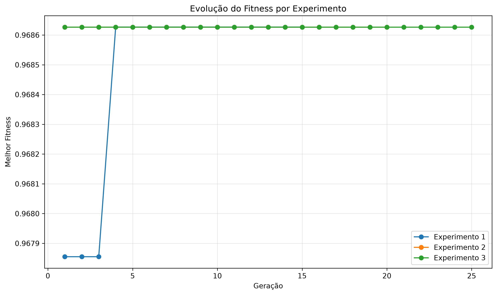
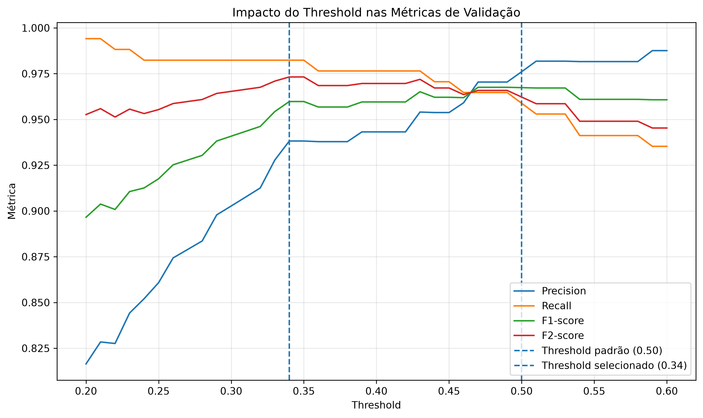
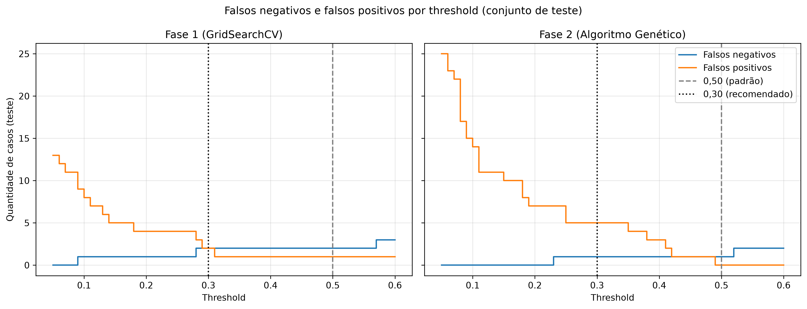
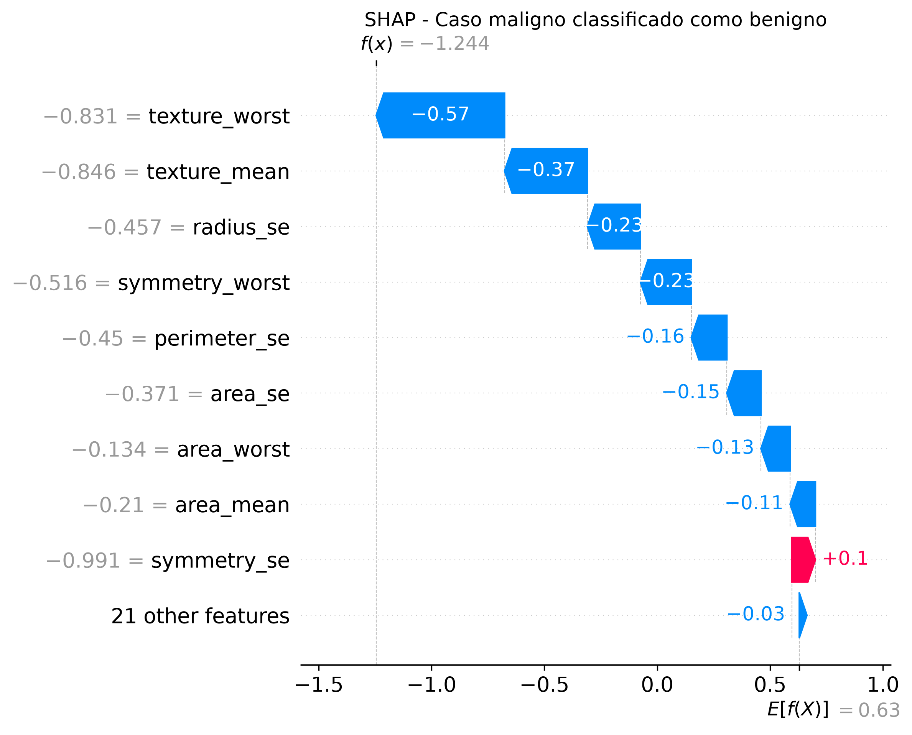

# Arquitetura da Solução

## 1. Visão Geral

Este documento descreve a arquitetura implementada para o **Tech Challenge – Fase 2**, Projeto 1: **Otimização de Modelos de Diagnóstico**.

A solução evolui o modelo de classificação de câncer de mama desenvolvido na Fase 1, incorporando:

- otimização de hiperparâmetros por Algoritmo Genético;
- definição de threshold de decisão;
- explicabilidade com SHAP;
- integração com LLM para interpretação dos resultados;
- disponibilização do modelo através de API REST;
- logging e monitoramento;
- containerização com Docker;
- escalabilidade automática com Kubernetes e HPA;
- testes automatizados.

A arquitetura foi organizada para separar treinamento, inferência, explicabilidade, interpretação e infraestrutura.

### Resumo dos resultados

| Indicador (conjunto de teste, 114 casos) | Fase 1 (GridSearchCV) | Fase 2 (Algoritmo Genético) |
| ---------------------------------------- | --------------------- | --------------------------- |
| Accuracy                                 | 0,9737                | **0,9912**                  |
| Precision                                | 0,9756                | **1,0000**                  |
| Recall                                   | 0,9524                | **0,9762**                  |
| F1-score                                 | 0,9639                | **0,9880**                  |
| ROC-AUC                                  | 0,9954                | **0,9977**                  |
| Falsos negativos                         | 2                     | **1**                       |
| Falsos positivos                         | 1                     | **0**                       |

---

# 2. Arquitetura Geral

```text
                         ┌─────────────────────────┐
                         │       Usuário /         │
                         │   Sistema Consumidor    │
                         └────────────┬────────────┘
                                      │
                                      │ HTTP / REST
                                      ▼
                         ┌─────────────────────────┐
                         │        FastAPI          │
                         │                         │
                         │ /health                 │
                         │ /features               │
                         │ /predict                │
                         │ /interpret              │
                         │ /metrics                │
                         └────────────┬────────────┘
                                      │
                    ┌─────────────────┼──────────────────┐
                    │                 │                  │
                    ▼                 ▼                  ▼
          ┌─────────────────┐ ┌──────────────┐ ┌─────────────────┐
          │ Modelo de ML    │ │     SHAP     │ │       LLM       │
          │ otimizado por   │ │ Explicação   │ │ Interpretação   │
          │ Algoritmo       │ │ do modelo    │ │ em linguagem    │
          │ Genético        │ │              │ │ natural         │
          └────────┬────────┘ └──────┬───────┘ └─────────────────┘
                   │                 │
                   ▼                 ▼
             Probabilidade      Principais fatores
                   │                 │
                   ▼                 │
             Threshold 0,34          │
                   │                 │
                   └────────┬────────┘
                            ▼
                  Resultado interpretável
```

A API atua como camada de integração entre o modelo de Machine Learning, o mecanismo de explicabilidade e a LLM.

---

# 3. Estrutura do Projeto

```text
FIAP_TechChallenge_02_2026/
│
├── api/
│   ├── __init__.py
│   └── main.py
│
├── src/
│   ├── __init__.py
│   ├── prediction_service.py
│   ├── explainability_service.py
│   ├── llm_service.py
│   └── logging_config.py
│
├── notebooks/
│   ├── 01_baseline_fase1.ipynb
│   ├── 02_algoritmo_genetico.ipynb
│   ├── 03_threshold_e_explicabilidade.ipynb
│   └── 04_llm.ipynb
│
├── data/
│   └── data.csv
│
├── models/
│   └── modelo_ga_fase2.joblib
│
├── results/
│   ├── baseline_fase1.json
│   ├── experimentos_algoritmo_genetico.csv
│   ├── comparacao_fase1_vs_ga.csv
│   ├── resultado_final_ga.json
│   ├── 02_evolucao_fitness_ga.png
│   ├── threshold_otimizado.json
│   ├── 03_analise_threshold.png
│   ├── importancia_variaveis_shap.csv
│   ├── analise_threshold_030.csv
│   ├── comparacao_shap_fase1_vs_ga.csv
│   ├── gráficos (threshold, SHAP, falso negativo)
│   ├── avaliacao_casos_llm.csv / .json
│   ├── avaliacao_qualidade_llm.csv
│   ├── avaliacao_automatica_llm.csv
│   ├── avaliacao_llm_juiz.csv
│   └── comparacao_prompts_v1_v2.csv
│
├── tests/                      # testes automatizados (pytest)
│   ├── test_api.py
│   ├── test_prediction_service.py
│   └── test_explainability_service.py
│
├── scripts/                    # execução manual (API em execução)
│   ├── test_predict_manual.py
│   ├── test_interpret_manual.py
│   └── load_test.py
│
├── docs/
│   ├── arquitetura.md
│   └── evidencias/
│
├── k8s/
│   ├── deployment.yaml
│   ├── service.yaml
│   ├── hpa.yaml
│   ├── secret.example.yaml
│   └── metrics-server-patch.yaml   # somente ambiente local
│
├── logs/
│   └── api.log
│
├── Dockerfile
├── docker-compose.yml
├── requirements.txt
├── .env.example        # .env real fica fora do Git (.gitignore)
└── README.md
```

---

# 4. Camada de Machine Learning

## 4.1 Modelo Base

O projeto utiliza o dataset **Breast Cancer Wisconsin Diagnostic**: 569 registros e 30 variáveis numéricas relacionadas às características dos tumores (357 benignos e 212 malignos).

A variável alvo é:

```text
B = Benigno  → 0
M = Maligno  → 1
```

A divisão treino/teste é a mesma em todos os notebooks, garantindo comparabilidade:

```text
test_size = 0,20  |  stratify = y  |  random_state = 42
Treino: 455 registros  |  Teste: 114 registros (42 malignos)
```

Na Fase 1 foram avaliados diferentes modelos de classificação. A Regressão Logística apresentou bom equilíbrio entre desempenho, interpretabilidade e estabilidade, sendo utilizada como base para a otimização da Fase 2.

## 4.2 Pipeline

O modelo é um `Pipeline` do scikit-learn:

```text
StandardScaler  →  LogisticRegression
```

A padronização faz parte do pipeline, de modo que, na validação cruzada, o scaler é ajustado apenas nos folds de treino, evitando vazamento de dados (_data leakage_).

---

# 5. Otimização com Algoritmo Genético

O Algoritmo Genético foi implementado manualmente seguindo os princípios estudados no módulo.

Cada indivíduo representa uma configuração de hiperparâmetros da Regressão Logística.

## 5.1 Representação dos genes

O cromossomo possui **3 genes inteiros**, cada um sendo um índice para uma lista de valores possíveis:

| Gene | Hiperparâmetro       | Valores possíveis                                          |
| ---- | -------------------- | ---------------------------------------------------------- |
| 0    | `C`                  | 0,001 · 0,01 · 0,1 · 0,5 · 1 · 2 · 5 · 10 · 100            |
| 1    | `class_weight`       | `None` · `balanced`                                        |
| 2    | par `solver/penalty` | liblinear/l1 · liblinear/l2 · saga/l1 · saga/l2 · lbfgs/l2 |

`solver` e `penalty` foram agrupados em um único gene porque nem toda combinação é válida no scikit-learn (por exemplo, `lbfgs` não suporta `l1`). Assim, crossover e mutação nunca geram indivíduos inválidos.

Exemplo:

```text
Indivíduo [2, 1, 1]

↓ decodificação

C = 0.1
class_weight = balanced
solver = liblinear
penalty = l2
```

O espaço de busca possui 9 × 2 × 5 = **90 combinações**.

## 5.2 Operadores genéticos

| Operador          | Implementação                                                                   |
| ----------------- | ------------------------------------------------------------------------------- |
| População inicial | indivíduos aleatórios                                                           |
| Seleção           | roleta (probabilidade proporcional ao fitness)                                  |
| Crossover         | uniforme (cada gene vem de um dos pais com 50% de chance)                       |
| Mutação           | por gene: com probabilidade = taxa de mutação, o gene recebe outro valor válido |
| Elitismo          | os _k_ melhores indivíduos passam direto para a próxima geração                 |
| Cache             | indivíduos já avaliados não são retreinados                                     |

## 5.3 Função fitness

A avaliação utiliza validação cruzada estratificada com 5 folds, somente sobre o conjunto de treinamento:

```text
fitness = 0,50 × Recall + 0,30 × F1-score + 0,20 × ROC-AUC
```

Foi dada maior importância ao Recall devido à natureza do problema de diagnóstico, em que falsos negativos (casos malignos classificados como benignos) possuem relevância especial. F1 e ROC-AUC evitam que o algoritmo favoreça modelos que simplesmente classificam tudo como maligno.

## 5.4 Experimentos

Foram realizados três experimentos com diferentes configurações:

| Experimento | População | Gerações | Mutação | Elitismo | Melhor fitness | Recall CV | F1 CV  | ROC-AUC CV | Avaliações únicas | Tempo  |
| ----------- | --------- | -------- | ------- | -------- | -------------- | --------- | ------ | ---------- | ----------------- | ------ |
| 1           | 20        | 15       | 0,05    | 2        | 0,9686         | 0,9588    | 0,9674 | 0,9949     | 61                | 8,6 s  |
| 2           | 30        | 20       | 0,10    | 2        | 0,9686         | 0,9588    | 0,9674 | 0,9949     | 79                | 12,4 s |
| 3           | 40        | 25       | 0,20    | 4        | 0,9686         | 0,9588    | 0,9674 | 0,9949     | 89                | 13,5 s |



**Análise:**

- Os três experimentos convergiram para o mesmo melhor fitness (0,9686), o que indica que a solução encontrada é robusta às configurações testadas.
- Nos Experimentos 2 e 3, o ótimo já estava na população inicial (geração 1): com 30 e 40 indivíduos aleatórios, a população cobre boa parte das 90 combinações.
- O Experimento 1, com 20 indivíduos, precisou do processo evolutivo (seleção, crossover e mutação) para chegar ao ótimo na 4ª geração, avaliando 61 combinações. É o experimento que evidencia o funcionamento dos operadores genéticos.
- O Experimento 3 avaliou 89 combinações (praticamente todo o espaço) para o mesmo resultado, com maior custo.
- Como o espaço de busca é pequeno, configurações maiores aumentam o custo sem ganho de qualidade. O benefício do Algoritmo Genético cresce em espaços maiores (ver seção 25).

**Melhor indivíduo:**

```text
[2, 1, 1] → C = 0.1 | class_weight = balanced | solver = liblinear | penalty = l2
```

Como houve empate em fitness, o Experimento 1 foi adotado como vencedor por ter o menor custo computacional (61 avaliações, 8,6 s).

O melhor indivíduo foi selecionado utilizando somente os dados de treinamento e validação cruzada. O conjunto de teste permaneceu separado até a avaliação final.

## 5.5 Comparação com o modelo original

Resultados no conjunto de teste (threshold padrão 0,50):

| Modelo                      | Accuracy   | Precision  | Recall     | F1         | ROC-AUC    | FN    | FP    |
| --------------------------- | ---------- | ---------- | ---------- | ---------- | ---------- | ----- | ----- |
| GridSearchCV – Fase 1       | 0,9737     | 0,9756     | 0,9524     | 0,9639     | 0,9954     | 2     | 1     |
| Algoritmo Genético – Fase 2 | **0,9912** | **1,0000** | **0,9762** | **0,9880** | **0,9977** | **1** | **0** |

O modelo otimizado reduziu os falsos negativos de 2 para 1 e eliminou o falso positivo.

Como o conjunto de teste possui 114 casos (42 malignos), cada caso corresponde a cerca de 2,4 pontos de Recall; a melhoria é consistente com a validação cruzada, mas deve ser interpretada considerando o tamanho da amostra.

---

# 6. Threshold de Decisão

Além da otimização dos hiperparâmetros, foi analisado o threshold de classificação. O valor padrão de uma Regressão Logística é `0,50`.

## 6.1 Método de seleção

1. Foram geradas probabilidades _out-of-fold_ com `cross_val_predict` (5 folds) **somente sobre o treino**.
2. Foram avaliados thresholds de 0,20 a 0,60 (passo 0,01).
3. O critério foi **maximizar o F2-score** (que dá peso duas vezes maior ao Recall do que à Precision), com desempate por Recall e depois por F1.

Threshold selecionado: **0,34**

| Threshold (validação cruzada) | Precision  | Recall     | F1         | F2         |
| ----------------------------- | ---------- | ---------- | ---------- | ---------- |
| 0,30                          | 0,9027     | 0,9824     | 0,9408     | 0,9653     |
| **0,34**                      | **0,9382** | **0,9824** | **0,9598** | **0,9732** |
| 0,50                          | 0,9760     | 0,9588     | 0,9674     | 0,9622     |

Na validação cruzada, o threshold 0,34 aumentou o Recall de 95,9% para 98,2% (cerca de 4 casos malignos a menos classificados como benignos entre os 170 malignos do treino).



## 6.2 Resultado no conjunto de teste

| Threshold | Accuracy | Precision | Recall | F1     | TN  | FP  | FN  | TP  |
| --------- | -------- | --------- | ------ | ------ | --- | --- | --- | --- |
| 0,50      | 0,9912   | 1,0000    | 0,9762 | 0,9880 | 72  | 0   | 1   | 41  |
| 0,34      | 0,9474   | 0,8913    | 0,9762 | 0,9318 | 67  | 5   | 1   | 41  |

No conjunto de teste, o threshold 0,34 **não reduziu** os falsos negativos (1 em ambos) e acrescentou 5 falsos positivos.

**Decisão:** o threshold 0,34 foi mantido como configuração da API por ser a escolha feita sem usar o conjunto de teste e por refletir a prioridade clínica de triagem: um falso positivo leva a exames adicionais, enquanto um falso negativo pode atrasar o tratamento. O resultado no teste mostra que esse ganho de sensibilidade não se confirmou na amostra de 114 casos, e essa limitação é registrada de forma transparente.

O fluxo de decisão é:

```text
Probabilidade de malignidade
           │
           ▼
Probabilidade >= 0,34
           │
      ┌────┴────┐
     Sim       Não
      ▼         ▼
   Maligno    Benigno
```

O threshold é armazenado separadamente em `results/threshold_otimizado.json`, permitindo alterá-lo (por exemplo, voltar para 0,50) sem treinar novamente o modelo.

Trocar para 0,50 **com base no resultado do teste** seria usar o conjunto de teste para tomar uma decisão de modelagem (vazamento), e as métricas reportadas para 0,50 deixariam de ser uma estimativa imparcial. Por isso a API mantém 0,34.

## 6.3 Recomendação da avaliação da Fase 1: threshold 0,30

Na avaliação da Fase 1 foi recomendado reduzir o threshold para 0,30 e verificar se os 2 falsos negativos seriam eliminados. A análise (notebook 03) foi feita para os dois modelos, como análise de sensibilidade:

| Modelo                      | Threshold | Recall | Precision | F1     | FN  | FP  |
| --------------------------- | --------- | ------ | --------- | ------ | --- | --- |
| Fase 1 (GridSearchCV)       | 0,50      | 0,9524 | 0,9756    | 0,9639 | 2   | 1   |
| Fase 1 (GridSearchCV)       | 0,30      | 0,9524 | 0,9524    | 0,9524 | 2   | 2   |
| Fase 2 (Algoritmo Genético) | 0,50      | 0,9762 | 1,0000    | 0,9880 | 1   | 0   |
| Fase 2 (Algoritmo Genético) | 0,30      | 0,9762 | 0,8913    | 0,9318 | 1   | 5   |

- Com 0,30, os falsos negativos **não foram eliminados** em nenhum dos modelos.
- No modelo da Fase 1, um caso maligno recebeu probabilidade de 0,088; zerar os falsos negativos exigiria threshold ≤ 0,088, com 9 falsos positivos.
- No modelo otimizado, o caso restante recebeu 0,224; zerar os falsos negativos exigiria threshold ≤ 0,22, com 7 falsos positivos. Esse valor foi encontrado observando o próprio teste e, por isso, não foi adotado.
- Na validação cruzada, 0,30 teve o mesmo Recall de 0,34 (0,9824) com Precision menor (0,9027 contra 0,9382); por isso o critério F2 selecionou 0,34.

**Conclusão:** a redução de falsos negativos (2 → 1) veio da otimização com Algoritmo Genético, e não do threshold.



---

# 7. Explicabilidade com SHAP

Foi utilizado **SHAP (SHapley Additive exPlanations)** para aumentar a interpretabilidade das previsões.

- Explainer: `shap.LinearExplainer`, adequado para Regressão Logística;
- Dados de referência (_background_): conjunto de treino padronizado;
- Os valores SHAP estão na escala de **log-odds**: valores positivos aumentam a tendência para malignidade e negativos a reduzem.

O SHAP é usado em dois níveis:

**Global** — variáveis mais influentes no conjunto de teste (média do |SHAP|):

| #   | Variável             | Importância média |
| --- | -------------------- | ----------------- |
| 1   | texture_worst        | 0,544             |
| 2   | radius_worst         | 0,404             |
| 3   | concave points_worst | 0,362             |
| 4   | perimeter_worst      | 0,358             |
| 5   | area_worst           | 0,353             |

**Individual** — para cada paciente, são selecionados os cinco fatores com maior valor absoluto de contribuição SHAP. Cada fator retorna:

```json
{
  "variavel": "radius_se",
  "valor": 1.291,
  "valor_shap": 1.4634,
  "efeito": "aumenta a tendência para malignidade"
}
```

`valor` é o valor original da variável (não padronizado) e `valor_shap` é a contribuição em log-odds.

A explicabilidade ajuda a compreender o comportamento do modelo, mas não representa causalidade médica.

## 7.1 Consistência entre modelos

Como na Fase 1 (Regressão Logística × Random Forest), a consistência das explicações foi verificada entre o modelo da Fase 1 e o modelo otimizado:

- 8 das 10 variáveis mais importantes são as mesmas nos dois modelos;
- correlação de Spearman entre as importâncias das 30 variáveis: 0,70;
- `texture_worst` é a variável mais importante em ambos.

As importâncias absolutas do modelo otimizado são menores porque o Algoritmo Genético escolheu uma regularização mais forte (C = 0,1 contra C = 1), que distribui o peso entre variáveis correlacionadas (raio, perímetro e área). A otimização manteve a lógica de decisão do modelo.

## 7.2 Análise do falso negativo restante

O único caso maligno classificado como benigno (probabilidade 0,224) possui **textura baixa**: `texture_worst` e `texture_mean` estão por volta do percentil 21 do treino, e a textura é a variável mais importante do modelo. As medidas de tamanho estão próximas da mediana e não compensam esse efeito.

É um tumor maligno com perfil semelhante ao de tumores benignos nas variáveis que o modelo mais utiliza, o que reforça o uso do sistema como apoio à decisão e a importância de dados adicionais (textos clínicos e imagens) no Módulo 3.



---

# 8. Integração com LLM

Uma LLM pré-treinada (API da OpenAI; o modelo é configurado pela variável `LLM_MODEL`, sem alteração de código) é utilizada para transformar os resultados técnicos em uma explicação estruturada em linguagem natural.

O modelo de linguagem não realiza a classificação. A classificação continua sendo responsabilidade exclusiva do modelo de Machine Learning.

```text
Modelo ML
   │
   ├── Probabilidade
   ├── Threshold
   └── Classificação
           │
           ▼
         SHAP
           │
           ▼
  Principais fatores
           │
           ▼
     Prompt estruturado
           │
           ▼
          LLM
           │
           ▼
Explicação em linguagem natural
```

## 8.1 Tolerância a falhas

- O cliente da OpenAI é criado somente na primeira chamada: sem `OPENAI_API_KEY`, a API inicia normalmente e `/predict` continua funcionando.
- Cada chamada tem timeout de 60 segundos e até 2 novas tentativas.
- Se a LLM falhar, `/interpret` responde `200` com a probabilidade, a classificação e os fatores SHAP, `explicacao_llm: null` e um campo `aviso`.
- A mensagem de erro original da OpenAI não é repassada ao usuário; o log registra apenas o tipo do erro.

---

# 9. Prompt Engineering

O prompt evoluiu em duas versões. Técnicas utilizadas na v1:

- **Definição de papel (role prompting):** a LLM atua como assistente de apoio à interpretação de um modelo de ML, não como médico;
- **Restrições explícitas:** não realizar novo diagnóstico, não alterar a classificação, não inventar informações clínicas e usar somente os dados fornecidos;
- **Contexto estruturado:** probabilidade, threshold, classificação e fatores SHAP em seções fixas;
- **Formato de saída definido:** resposta obrigatória em quatro seções.

```text
1. Resumo do resultado
2. Principais fatores que influenciaram a previsão
3. Interpretação do resultado
4. Limitações e recomendação de revisão clínica
```

A leitura das respostas da v1 mostrou dois pontos fracos: no caso próximo ao threshold (34,94% para um limite de 34%, um falso positivo) a LLM não destacou que a decisão estava na fronteira, e os fatores eram apresentados só com valores brutos, pouco acionáveis para o médico.

A **v2**, utilizada pela API, acrescenta:

- **Zona de decisão:** alerta explícito quando a probabilidade está a menos de 10 pontos percentuais do threshold;
- **Percentil de cada fator** em relação ao treino (baixo, intermediário ou alto);
- **Desempenho do modelo** no teste (Recall e Precision);
- **Campo de observações clínicas em texto**, base para a integração com dados textuais no Módulo 3;
- **Seção "Pontos de atenção para o profissional de saúde"**, sem recomendar tratamentos ou exames;
- Formato adequado para probabilidades extremas (`>99,99%` em vez de `100,00%`, que sugeriria certeza).

A classe real do paciente **não** é enviada ao prompt; ela é usada apenas na avaliação experimental.

---

# 10. Avaliação das Interpretações da LLM

Foram selecionados quatro casos do conjunto de teste com perfis diferentes:

| Caso                 | Probabilidade | Classificação do modelo | Classe real              |
| -------------------- | ------------- | ----------------------- | ------------------------ |
| Alta probabilidade   | >99,9%        | Maligno                 | Maligno                  |
| Próximo ao threshold | 34,94%        | Maligno                 | Benigno (falso positivo) |
| Baixa probabilidade  | 0,01%         | Benigno                 | Benigno                  |
| Falso negativo       | 22,37%        | Benigno                 | Maligno (falso negativo) |

Os dois erros do modelo foram incluídos para observar se a LLM mantém a cautela quando o modelo erra.

A qualidade foi avaliada de três formas complementares.

## 10.1 Avaliação manual (prompt v1)

Critérios (escala de 1 a 5):

- **Fidelidade:** respeita os valores fornecidos pelo modelo e pelo SHAP;
- **Clareza:** apresenta o resultado de forma compreensível;
- **Segurança:** não apresenta a classificação como diagnóstico definitivo;
- **Completude:** contém resultado, fatores, interpretação e limitações.

| Caso                 | Fidelidade | Clareza | Segurança | Completude | Média |
| -------------------- | ---------- | ------- | --------- | ---------- | ----- |
| Alta probabilidade   | 5          | 5       | 5         | 5          | 5,0   |
| Próximo ao threshold | 5          | 5       | 5         | 5          | 5,0   |
| Baixa probabilidade  | 5          | 5       | 5         | 5          | 5,0   |

As notas foram atribuídas manualmente pelo grupo após a leitura das respostas, registradas em `results/avaliacao_casos_llm.json`. Por serem atribuídas pelos próprios autores, foram complementadas pelas avaliações a seguir.

**Observações qualitativas:**

- Em todos os casos, a LLM reproduziu corretamente a probabilidade, o threshold, a classificação e os sinais dos valores SHAP, sem inventar informações clínicas;
- No caso próximo ao threshold, a LLM separou corretamente os fatores que aumentam e reduzem a tendência para malignidade, mas não destacou explicitamente que a probabilidade estava a menos de 1 ponto percentual do limite de decisão, uma informação relevante para o médico;
- As explicações descrevem os fatores pelo nome técnico e valor bruto, sem indicar se o valor é alto ou baixo em relação à população estudada.

Esses pontos motivaram o prompt v2.

## 10.2 Avaliação automática

Verificações objetivas e reprodutíveis aplicadas a cada resposta: probabilidade, classificação e threshold corretos; proporção dos 5 fatores SHAP citados; seções completas; recomendação de revisão por profissional de saúde; ausência de linguagem de certeza ("certamente", "diagnóstico confirmado"); e, nos casos da zona de incerteza, sinalização da proximidade do limite.

## 10.3 Avaliação por LLM (LLM-as-a-judge)

Uma segunda chamada à LLM recebe os dados reais do modelo, a resposta e uma rubrica (fidelidade, clareza, segurança, completude e acionabilidade, de 1 a 5). A classe real não é informada. Como a mesma família de modelo gera e avalia, essa nota é usada em conjunto com as demais, e não isoladamente.

## 10.4 Resultado v1 × v2

Média dos 4 casos (`results/comparacao_prompts_v1_v2.csv`):

| Versão | Score automático | Fidelidade |  Clareza | Segurança | Completude | Acionabilidade | Média do juiz |
| ------ | ---------------: | ---------: | -------: | --------: | ---------: | -------------: | ------------: |
| v1     |             0,97 |   **5,00** |     4,25 |      5,00 |   **5,00** |           2,25 |      **4,30** |
| v2     |         **1,00** |       2,50 | **4,50** |      5,00 |       4,75 |       **3,25** |          4,00 |

- **Avaliação automática:** a v2 acertou 100% das verificações. A única falha da v1 foi no caso próximo ao threshold (falso positivo), em que não sinalizou que a probabilidade (34,94%) estava a menos de 1 ponto percentual do limite; a v2 sinalizou.
- **Acionabilidade:** subiu de 2,25 para 3,25, porque a v2 contextualiza os fatores com percentis e indica a margem até o threshold. Clareza também melhorou (4,25 → 4,50). Segurança ficou em 5,0 nas duas versões.
- **Fidelidade (5,00 → 2,50): limitação do avaliador, não alucinação.** As justificativas do juiz penalizam a v2 por citar as métricas do teste, a zona de incerteza e a escala log-odds "sem suporte nos dados". Essas informações estavam no prompt da v2, mas o prompt do juiz recebe apenas probabilidade, threshold, classificação e fatores. A verificação automática confirma que os números da v2 estão corretos.
- **O que a v2 ainda não resolveu:** o juiz considera a seção "Pontos de atenção" genérica, pois repete as métricas do modelo em vez de apontar o que revisar no caso. É o próximo ponto de melhoria do prompt.
- **Lição:** em LLM-as-a-judge, o avaliador precisa receber o mesmo contexto que o gerador; caso contrário, penaliza informações corretas. Como a média do juiz (4,30 → 4,00) é afetada por esse viés, a comparação considera os três métodos em conjunto.

---

# 11. API REST

A solução é disponibilizada através de **FastAPI**, com documentação automática (Swagger) em `/docs`.

| Método | Rota         | Descrição                                                          |
| ------ | ------------ | ------------------------------------------------------------------ |
| GET    | `/`          | Verifica se a aplicação está online                                |
| GET    | `/health`    | Health check usado pelas probes do Kubernetes                      |
| GET    | `/features`  | Lista as 30 variáveis esperadas pelo modelo                        |
| POST   | `/predict`   | Probabilidade, threshold e classificação                           |
| POST   | `/interpret` | Predição + SHAP + explicação da LLM (com fallback se a LLM falhar) |
| GET    | `/metrics`   | Métricas no formato Prometheus                                     |

Exemplo de `/health`:

```json
{
  "status": "ok",
  "modelo": "carregado"
}
```

Em `/predict` e `/interpret`, o Swagger já traz um paciente de exemplo. Variáveis ausentes retornam erro `400` com a lista do que falta.

Exemplo de `/predict`:

```json
{
  "probabilidade_malignidade": 0.9999,
  "threshold": 0.34,
  "classificacao": "Maligno"
}
```

---

# 12. Logging

Foi implementado logging centralizado da API em `logs/api.log`.

Cada requisição registra método, rota, status HTTP e tempo de processamento:

```text
Método=POST | Rota=/predict | Status=200 | Tempo=0.0152s
```

Eventos relacionados às previsões e erros também são registrados.

O sistema não registra informações sensíveis: nem a chave da API da OpenAI, nem as 30 variáveis clínicas do paciente (apenas classificação e probabilidade).

---

# 13. Monitoramento

A API expõe métricas no formato Prometheus em `GET /metrics`:

| Métrica                         | Tipo de informação        |
| ------------------------------- | ------------------------- |
| `api_requisicoes_total`         | quantidade de requisições |
| `api_tempo_requisicao_segundos` | tempo de processamento    |

Nesta fase, as métricas são expostas pela API; a coleta por um servidor Prometheus e a visualização em Grafana estão previstas como evolução futura.

---

# 14. Docker

A aplicação utiliza Docker para garantir um ambiente reproduzível.

| Serviço (`docker-compose.yml`) | Porta | Função                                                   |
| ------------------------------ | ----- | -------------------------------------------------------- |
| `api`                          | 8000  | API FastAPI                                              |
| `jupyter`                      | 8888  | Execução dos notebooks com as mesmas dependências da API |

Serviços auxiliares adicionados no início do projeto (PostgreSQL e n8n) foram removidos por não participarem de nenhum fluxo da solução.

Para execução sem Docker, o projeto pode ser executado em um ambiente virtual:

```bash
python -m venv .venv
source .venv/bin/activate        # Windows: .venv\Scripts\activate
pip install -r requirements.txt
uvicorn api.main:app --reload
```

Os notebooks utilizam caminhos `/app/...` e devem ser executados no container `jupyter`.

---

# 15. Kubernetes

Kubernetes foi utilizado para demonstrar a escalabilidade automática exigida pelo projeto.

| Recurso                 | Função                                                                                                                                                                      |
| ----------------------- | --------------------------------------------------------------------------------------------------------------------------------------------------------------------------- |
| Deployment              | Executa os pods da API: `requests` 100m CPU / 256Mi, `limits` 500m CPU / 512Mi; probes de readiness e liveness em `/health` com `timeoutSeconds: 5` e `failureThreshold: 3` |
| Service                 | Tipo `LoadBalancer` na porta 8010 (`targetPort` 8000); no Docker Desktop a API fica em `http://localhost:8010`, deixando a porta 8000 livre para o docker compose           |
| HorizontalPodAutoscaler | Escala os pods com base na CPU                                                                                                                                              |
| Secret                  | Armazena `OPENAI_API_KEY` e `LLM_MODEL`                                                                                                                                     |

O repositório contém apenas `secret.example.yaml`; o arquivo com valores reais não é versionado.

---

# 16. Escalabilidade Automática

O HPA foi configurado com:

```text
Mínimo de réplicas: 1
Máximo de réplicas: 5
Meta de utilização de CPU: 60%
```

```text
Carga normal → 1 Pod
      │
      ▼
Aumento de requisições → CPU aumenta
      │
      ▼
HPA detecta utilização acima da meta
      │
      ▼
Kubernetes cria novos Pods (até 5)
      │
      ▼
Carga diminui → HPA reduz gradualmente as réplicas
```

---

# 17. Metrics Server

O HPA obtém a utilização de CPU dos pods por meio do **Kubernetes Metrics Server** (e não das métricas Prometheus da API).

No Docker Desktop, o Metrics Server falhou inicialmente com `x509: cannot validate certificate ... because it doesn't contain any IP SANs`. Foi necessário permitir a coleta das métricas do kubelet sem validação de certificado TLS (`--kubelet-insecure-tls`, em `k8s/metrics-server-patch.yaml`), configuração aplicada apenas ao ambiente de desenvolvimento e não recomendada para produção.

Após a configuração, `kubectl top nodes` passou a retornar métricas:

```text
CPU: 252m | CPU%: 1% | Memória: 2872Mi | Memória%: 18%
```

---

# 18. Teste de Escalabilidade

Foi realizado um teste de carga (`scripts/load_test.py`, opção 6 do `projeto.bat`) contra `POST /predict` da API no Kubernetes. O `/interpret` não foi utilizado para não consumir créditos da OpenAI.

| Parâmetro                 | Execução 1 (probes padrão) | Execução final (probes ajustadas) |
| ------------------------- | -------------------------- | --------------------------------- |
| Trabalhadores simultâneos | 50                         | 50                                |
| Duração                   | 120 s                      | 120 s                             |
| Requisições enviadas      | 42.100                     | 26.150                            |
| Respostas HTTP 200        | 16.099 (38,2%)             | 16.017 (61,3%)                    |

Na primeira execução, com o timeout padrão das probes (1 segundo), o `/health` demorava mais que isso com a CPU saturada e o Kubernetes reiniciava pods. Com `timeoutSeconds: 5` a taxa de sucesso subiu de 38% para 61%. As falhas restantes ocorrem principalmente enquanto os novos pods ainda estão sendo criados.

Comportamento observado na execução final:

| Momento         | CPU / meta | Réplicas |
| --------------- | ---------- | -------- |
| Antes do teste  | 2% / 60%   | 1        |
| Início da carga | 500% / 60% | 1        |
| HPA reage       | 473% / 60% | 2        |
| Escala final    | —          | 4        |

Os novos pods ficaram prontos (1/1) em cerca de 20 segundos. O Kubernetes aumentou automaticamente as réplicas de 1 para 4.

Este é um **teste de estresse para validar o HPA**, e não um benchmark de desempenho. Medições de latência (p50/p95) com carga controlada ficam como evolução futura.

---

# 19. Evidências do Autoscaling

As evidências estão em `docs/evidencias/`.

**Evolução do HPA** — utilização de CPU acima da meta e aumento das réplicas:


**Criação automática de Pods** — novos pods passando por `Pending → ContainerCreating → Running (0/1) → Running (1/1)`:


**Resultado do teste de carga** — volume de requisições utilizado para provocar o escalamento:


---

# 20. Testes Automatizados

A solução utiliza `pytest`. Foram criados testes para:

- health check;
- listagem de variáveis;
- modelo de previsão (probabilidade entre 0 e 1 e classificação válida);
- geração e estrutura dos fatores SHAP;
- endpoints `/predict`, `/interpret` e `/metrics`;
- `/interpret` com a LLM indisponível (deve responder 200 com predição e SHAP);
- variável ausente em `/predict` (deve responder 400).

**Resultado: 15 testes aprovados**, inclusive sem `OPENAI_API_KEY` configurada.

Nos testes da integração com LLM é utilizado `mock`, o que evita consumo e custos da API externa e dependência de conexão durante os testes.

As chamadas reais à LLM foram validadas separadamente pelos scripts manuais em `scripts/` e pelo notebook `04_llm.ipynb`.

```bash
pytest tests/ -v
```

---

# 21. Segurança e Configuração

Dados sensíveis não são armazenados no código. As configurações são fornecidas por variáveis de ambiente:

```text
OPENAI_API_KEY
LLM_MODEL
```

O arquivo `.env` está no `.gitignore`; o repositório contém apenas `.env.example`, sem credenciais reais.

Para Kubernetes, os valores sensíveis são armazenados em `Secret`.

---

# 22. Decisões de Implementação

| Decisão                                           | Motivo                                                                                                                                          |
| ------------------------------------------------- | ----------------------------------------------------------------------------------------------------------------------------------------------- |
| Regressão Logística como modelo principal         | Bom desempenho, treinamento rápido, probabilidades calibráveis, compatibilidade com SHAP e interpretabilidade superior a modelos mais complexos |
| Algoritmo Genético implementado manualmente       | Atende diretamente ao requisito e permite controlar cada operador                                                                               |
| `solver` e `penalty` em um único gene             | Impede combinações inválidas durante crossover e mutação                                                                                        |
| Recall com peso 50% no fitness                    | Reduzir falsos negativos é prioritário em diagnóstico                                                                                           |
| Cache de fitness                                  | Evita retreinar indivíduos repetidos e reduz o tempo de execução                                                                                |
| Threshold escolhido por F2 em dados _out-of-fold_ | Prioriza sensibilidade sem utilizar o conjunto de teste                                                                                         |
| Threshold fora do modelo                          | Permite ajuste sem novo treinamento                                                                                                             |
| SHAP (`LinearExplainer`)                          | Explicabilidade global e individual exata para modelos lineares                                                                                 |
| LLM apenas como camada de comunicação             | A classificação permanece determinística e auditável                                                                                            |
| FastAPI                                           | Simplicidade, desempenho, Swagger automático e integração com Python                                                                            |
| Docker                                            | Reprodutibilidade                                                                                                                               |
| Kubernetes + HPA                                  | Escalabilidade automática baseada em demanda                                                                                                    |
| Formato Prometheus                                | Padrão de mercado para exposição de métricas                                                                                                    |

---

# 23. Fluxo Completo da Solução

```text
Dados do paciente
       │
       ▼
FastAPI → Validação dos 30 atributos
       │
       ▼
Modelo otimizado por Algoritmo Genético
       │
       ▼
Probabilidade de malignidade → Threshold 0,34 → Classificação
       │
       ▼
SHAP → Principais fatores
       │
       ▼
Prompt estruturado → LLM
       │
       ▼
Resposta JSON (classificação + fatores + interpretação)
```

Paralelamente, dois fluxos independentes de observabilidade:

```text
Requisições à API                     Pods em execução
     │                                       │
     ├── Logging (logs/api.log)              ▼
     │                                Metrics Server (CPU / memória)
     └── /metrics (formato Prometheus)       │
                                             ▼
                                            HPA
                                             │
                                             ▼
                                   Escalabilidade de 1 até 5 Pods
```

---

# 24. Desafios Enfrentados e Soluções

| Desafio                                                                                             | Solução                                                                                                                                             |
| --------------------------------------------------------------------------------------------------- | --------------------------------------------------------------------------------------------------------------------------------------------------- |
| Combinações inválidas de `solver` e `penalty` geradas por crossover/mutação                         | Agrupamento de `solver/penalty` em um único gene                                                                                                    |
| Custo de retreinar indivíduos repetidos ao longo das gerações                                       | Cache de fitness por indivíduo                                                                                                                      |
| Escolher o threshold sem contaminar o conjunto de teste                                             | Probabilidades _out-of-fold_ geradas apenas no treino                                                                                               |
| Threshold 0,34 não confirmou ganho de Recall no teste                                               | Resultado documentado; threshold externo ao modelo permite ajuste sem retreino                                                                      |
| Metrics Server não coletava métricas no Docker Desktop (certificado do kubelet)                     | `--kubelet-insecure-tls` apenas no ambiente local                                                                                                   |
| HPA depende de `resources.requests` de CPU no Deployment                                            | Definição de requests no `deployment.yaml`                                                                                                          |
| Custo e dependência externa da LLM nos testes                                                       | `mock` nos testes automatizados; validação real em testes manuais                                                                                   |
| Avisos de depreciação do parâmetro `penalty` no scikit-learn 1.8                                    | Verificado que a penalidade L1 continua sendo aplicada (coeficientes zerados); avisos suprimidos nos notebooks                                      |
| Pods reiniciados durante o teste de carga (probe com timeout de 1 s)                                | `timeoutSeconds: 5` e `failureThreshold: 3`; sucesso de 38% → 61%                                                                                   |
| API não iniciava sem `OPENAI_API_KEY`                                                               | Cliente da OpenAI criado apenas na primeira chamada                                                                                                 |
| Falha da LLM derrubava o `/interpret` inteiro                                                       | Fallback: resposta com predição e SHAP, `explicacao_llm: null` e aviso                                                                              |
| Scripts manuais dentro de `tests/` eram executados pelo pytest (exigiam a API e consumiam créditos) | Movidos para `scripts/`                                                                                                                             |
| Serviços sem uso no ambiente (PostgreSQL e n8n)                                                     | Removidos do `docker-compose.yml`                                                                                                                   |
| LLM-as-a-judge penalizou informações corretas da v2 (fidelidade 2,5)                                | Causa identificada nas justificativas: o juiz não recebia o mesmo contexto do gerador. Resultado documentado e combinado com a avaliação automática |

---

# 25. Limitações

- O modelo foi treinado com um dataset público e não representa uma validação clínica para utilização em ambiente hospitalar real;
- O conjunto de teste é pequeno (114 casos, 42 malignos), de modo que diferenças de um ou dois casos alteram as métricas de forma relevante;
- O espaço de busca do Algoritmo Genético (90 combinações) é pequeno; os três experimentos convergiram para a mesma solução;
- A classificação produzida pelo modelo não deve ser interpretada como diagnóstico médico definitivo;
- A LLM não realiza diagnóstico e não possui acesso a histórico clínico, exames adicionais ou contexto médico completo;
- A avaliação da LLM utiliza poucos casos (4); o juiz é da mesma família de modelo que gera as respostas e não recebeu o mesmo contexto da v2, o que reduziu artificialmente a nota de fidelidade;
- A infraestrutura Kubernetes foi implementada localmente no Docker Desktop; um ambiente de produção exigiria configurações adicionais de segurança, alta disponibilidade, observabilidade e gestão de infraestrutura.

---

# 26. Evoluções Futuras

- Ampliar o espaço de busca do Algoritmo Genético (valores contínuos de `C`, `elasticnet`/`l1_ratio`, outros modelos da Fase 1), onde a busca evolutiva traz mais vantagem sobre a busca exaustiva;
- Seleção por torneio, que mantém pressão seletiva mesmo quando os fitness são muito próximos;
- Fornecer ao juiz o mesmo contexto do prompt gerador e tornar a seção "Pontos de atenção" específica para cada caso;
- Avaliação da LLM em um número maior de casos e com avaliadores humanos da área da saúde;
- Benchmark de latência (p50/p95/p99) com carga controlada;
- Implantação em ambiente de nuvem com infraestrutura como código;
- Persistência do histórico de previsões em banco de dados;
- Autenticação da API;
- Integração completa com Prometheus e Grafana;
- Validação clínica com datasets adicionais;
- Calibração das probabilidades;
- Integração com dados clínicos textuais e prontuários eletrônicos na LLM no Módulo 3.

---

# 27. Conclusão

A arquitetura implementada integra Machine Learning, Algoritmos Genéticos, explicabilidade, LLM e infraestrutura em uma solução única.

O Algoritmo Genético encontrou, nos três experimentos, a configuração `C = 0.1`, `class_weight = balanced`, `liblinear/l2`, que no conjunto de teste superou o modelo da Fase 1 em todas as métricas (Recall de 0,952 para 0,976, F1 de 0,964 para 0,988 e falsos negativos de 2 para 1).

O threshold de decisão foi analisado separadamente com dados _out-of-fold_. A redução para 0,30, recomendada na avaliação da Fase 1, foi testada e não eliminou os falsos negativos: o ganho de sensibilidade veio do Algoritmo Genético. O SHAP mostrou explicações consistentes entre os modelos e permitiu entender o falso negativo restante.

A LLM transformou essas informações técnicas em explicações estruturadas em linguagem natural, mantendo o modelo de Machine Learning como responsável pela classificação. O prompt evoluiu para uma versão com zona de incerteza, percentis e pontos de atenção, e a qualidade foi avaliada de forma manual, automática e por LLM.

A aplicação foi disponibilizada através de FastAPI, containerizada com Docker e monitorada com logging e métricas no formato Prometheus.

Por fim, Kubernetes, Metrics Server e Horizontal Pod Autoscaler demonstraram escalabilidade automática: durante o teste de carga, o ambiente escalou de uma para quatro réplicas, e o ajuste das probes elevou a taxa de sucesso de 38% para 61%.
